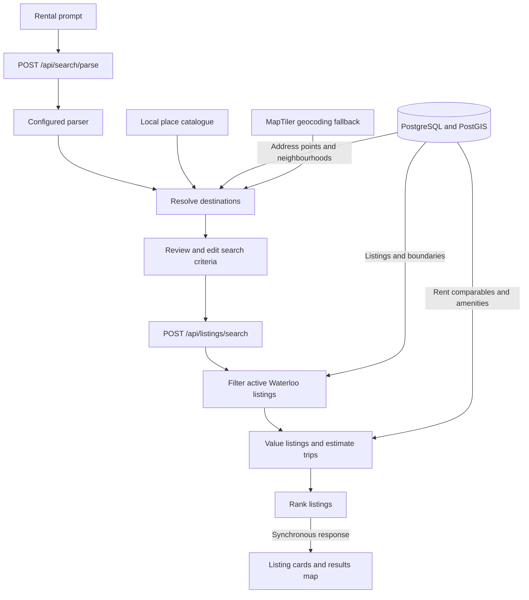
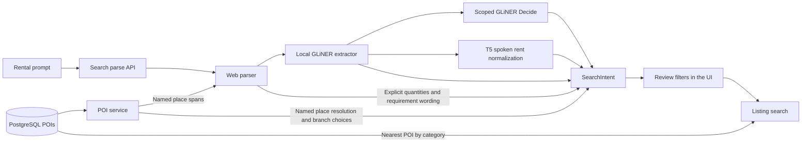

# Search and places

## Search flow

- The parser produces a structured `SearchIntent`. The browser can submit edited criteria directly to listing search and pause for a destination choice when a place is ambiguous. Waterloo landmarks and intersections resolve locally. Selected Kitchener places, including the GO station, can be commute destinations.
- Search returns up to 500 ranked listings.
- Search estimates commute times from straight-line distances and mode-specific assumptions. When configured, OpenTripPlanner serves map routes through `/api/route`. Waterloo neighbourhood crime scoring is disabled.

Source files include `apps/web/src/lib/parse/`, `apps/web/src/lib/api/runtime.ts`, `apps/web/src/lib/db/candidates.ts`, and `packages/shared/engine/`.

## Local extraction and place lookup

The [local extractor](../../apps/search/README.md) and [POI service](../../apps/poi/README.md)
are optional. The [Waterloo search benchmark](../waterloo-search-benchmarks.md)
records the workstation run with both services enabled.

- With the local extractor configured, the web parser sends the prompt and
  known place spans to GLiNER. A failed extractor request uses the basic parser.
  Without an extractor URL, the web app uses its configured AI provider and the
  basic fallback. GLiNER extracts source spans and the optional Decide model classifies choices
  such as travel mode from the relevant phrase. The T5 adapter normalizes spoken
  rent amounts such as “twenty-five hundred dollars.”
- The web parser validates the source offsets and handles explicit numeric
  evidence, including thousands separators in floor-area bounds. Criteria are
  required by default. Explicit preference or approximate wording can soften a
  criterion. Travel modes and time limits attach to the corresponding destination.
- The POI service indexes PostgreSQL place records alongside local landmarks,
  intersections, and aliases. An exact alias or street qualifier can resolve a
  specific place. Shared or fuzzy matches can require a choice. Generic requests
  such as “a supermarket” become category filters that listing search evaluates
  with PostGIS.

[Waterloo](Waterloo.md) · [Data imports](Data%20imports.md) · [Database](Database.md) · [Listing and area views](Listing%20and%20area%20views.md)
